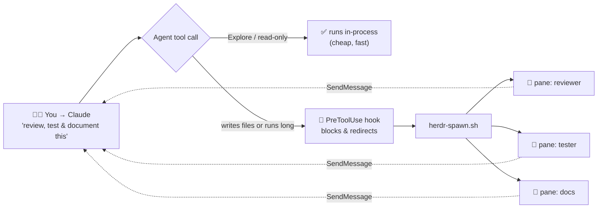

<div align="center">

# 🐑 herdr-claude-subagents

### Stop flying blind with Claude Code subagents.

**Every agent Claude delegates to becomes a real, named session in its own [Herdr](https://herdr.dev) pane.<br/>You can watch it, answer it, and interrupt it.**

[](https://docs.claude.com/en/docs/claude-code/plugins)
[](https://herdr.dev)
[](LICENSE)
[](#requirements)
[](https://github.com/rndbblnn/herdr-claude-subagents/stargazers)

<br/>



<br/>

[**Install**](#install) · [**How it works**](#how) · [**Configure**](#configure) · [**FAQ**](#faq) · [**Credits**](#credits)

</div>

---

## 😩 The problem

You ask Claude Code to review, test, and document in parallel. It fires off three subagents and then… **nothing.** There's a spinner, and you don't know what they're doing, whether one is stuck on a question, or how to stop the one going off the rails.

That's because the built-in `Agent` tool runs subagents **in-process**. They have no terminal, no process and no session id. Herdr finds agents by looking at what runs in each pane, so these never show up. **No hook can fix that**, because Herdr needs a real pane to report on.

## ✨ The fix

This plugin doesn't try to make invisible agents visible. **It makes them real.**

<table>
<tr>
<th width="50%">😶‍🌫️ Before: in-process subagents</th>
<th width="50%">🐑 After: herdr-claude-subagents</th>
</tr>
<tr>
<td>

- ❌ Not in Herdr's agent list
- ❌ Can't read what they're doing
- ❌ Can't answer their questions
- ❌ Can't interrupt just one
- ❌ Gone when they finish

</td>
<td>

- ✅ One named pane per agent
- ✅ `herdr agent read reviewer`, live
- ✅ Type straight into its pane
- ✅ Kill one, keep the rest
- ✅ Full transcript, real session id

</td>
</tr>
</table>

<a id="install"></a>

## 🚀 Install in 30 seconds

Inside Claude Code:

```text
/plugin marketplace add rndbblnn/herdr-claude-subagents
/plugin install herdr-claude-subagents@herdr-claude-subagents
```

Restart Claude Code. **That's it.** Next time Claude reaches for a subagent inside Herdr, it opens a pane instead.

> [!TIP]
> Outside Herdr the plugin does nothing at all (`HERDR_ENV != 1`), so it's safe to install everywhere.

<a id="how"></a>

## 🧠 How it works



Each task gets its own tab and each agent its own pane:

```text
workspace
├── tab "2"            ← you, the orchestrator
└── tab "review-auth"  ← one tab per task
    ├── pane reviewer  ← one pane per agent
    ├── pane tester
    └── pane docs
```

There are three moving parts:

| | Part | What it does |
|---|---|---|
| 🛑 | **The hook** (`hooks/route-agent-to-herdr.sh`) | A `PreToolUse` hook on `Agent`. **Inside Herdr only**, it blocks subagent types that can write files or run long, and points Claude to the spawner. Read-only lookups (`Explore`, `claude-code-guide`, `statusline-setup`) still run in-process. |
| 🐑 | **The spawner** (`scripts/herdr-spawn.sh`) | Starts one named `claude` session in a pane, in the task's tab, creating the tab on first use. The Herdr agent name, the Claude peer name and the session id all match, so `herdr agent read reviewer` and `SendMessage({to: "reviewer"})` reach the same pane. The child also knows who spawned it, so it can report back. |
| 📨 | **The return path** | With `--orchestrator`, every child gets a standing instruction in its system prompt: send results and task questions back to the parent with `SendMessage`, instead of asking in a pane nobody is watching. |
| 📖 | **The skill** (`skills/herdr-spawn`) | Teaches Claude how to spawn, drive and tear down a team. |

## 🎮 Drive it yourself

Claude does this on its own once the hook redirects a call, but you can spawn by hand too:

```bash
bash "$CLAUDE_PLUGIN_ROOT/scripts/herdr-spawn.sh" reviewer \
  --task review-auth --orchestrator <your session name> \
  --prompt "Review the diff on this branch. Report findings only."

herdr agent get reviewer      # idle | working | blocked | done
herdr agent read reviewer     # what is it doing right now?
bash "$CLAUDE_PLUGIN_ROOT/scripts/herdr-spawn.sh" reviewer --close   # done: pane and row go
herdr tab close <tab id>      # tear the whole team down
```

> [!NOTE]
> Add `--dry-run` to print the herdr commands without running anything.

<a id="configure"></a>

## ⚙️ Configure

Set these as env vars, for example in `settings.json` → `env`:

| Setting | Effect |
|---|---|
| `CC_HERDR_ALLOWED_AGENTS=bulk-reader,my-auditor` | More agent types that may stay in-process. List your own read-only agents here. |
| `CC_ALLOW_INPROCESS_AGENTS=1` | Turns the redirect off for one session. |

### 🌳 Show the hierarchy in Herdr's agent panel

The spawner labels each pane: every child shows its own name (not "claude") with `$under` = `↳ <parent>`, and the parent shows its own name. Add this to `~/.config/herdr/config.toml`, then run `herdr server reload-config`:

```toml
[ui.sidebar.agents.rows_by_agent]
claude = [
  ["state_icon", "terminal_title_stripped", { token = "$under", fg = "#7d8590" }],
  [{ token = "workspace", dim = true }, { token = "tab", dim = true }],
]
```

```text
● Refactor auth module          ← your session's own title
  local_playground · 1
● reviewer · ↳ local-playground-5d
  local_playground · review-auth
```

The first line is the pane's terminal title. Claude sets it to the `--name` the spawner gives each child, and to a summary of the conversation in your own sessions. The built-in `agent` token would show "claude" for every pane the spawner didn't start. Keep `ui.agent_panel_sort` on its default `"spaces"` so each team stays under its parent. `$team` and `$parent` are there too, for your own layouts and rules.

<a id="requirements"></a>

## 📦 Requirements

- [Herdr](https://herdr.dev) with its Claude integration installed, so it reports panes as agents
- `bash` and `awk`. **No `jq`, no Python, no Node** (`node` is only needed for the optional `--trust` flag)

<a id="faq"></a>

## 🩺 FAQ

<details>
<summary><b>Why not just make the in-process subagents show up in Herdr?</b></summary>
<br/>
It can't be done. Herdr's <code>pane report-agent</code> needs a real pane id, and an in-process subagent doesn't have one. Giving each agent a real session is the only way to make it watchable.
</details>

<details>
<summary><b>Won't this make cheap lookups slow?</b></summary>
<br/>
No. Read-only agent types like <code>Explore</code> stay in-process. Only agents that write files or run long get a pane. Add your own read-only agents to <code>CC_HERDR_ALLOWED_AGENTS</code>.
</details>

<details>
<summary><b>What happens when a child has a question?</b></summary>
<br/>
It asks its parent. The spawner tells every child to send task questions to the orchestrator with <code>SendMessage</code> and wait for the reply, rather than opening an AskUserQuestion dialog in its own pane. The parent answers or asks you. Permission prompts still show in the child's pane, and Herdr marks it <code>blocked</code>.
</details>

<details>
<summary><b>How do finished children leave the agent panel?</b></summary>
<br/>
The child starts its last report with <code>FINAL:</code>, and the parent runs <code>herdr-spawn.sh &lt;name&gt; --close</code>. That closes its pane, which removes its row, and the tab goes with its last pane. It isn't automatic on Herdr's <code>done</code> status, because that fires after every turn, including when a child is waiting for your answer.
</details>

<details>
<summary><b><code>herdr agent start failed for 'x' in pane …</code></b></summary>
<br/>
The child is probably stuck on Claude Code's "do you trust this folder?" dialog. <code>herdr pane read &lt;pane&gt;</code> will show it. The spawner checks for this up front. Pass <code>--trust</code> only for a directory you would trust yourself.
</details>

<details>
<summary><b>"Name already taken"</b></summary>
<br/>
Live agent names are unique. Close the old tab first.
</details>

<details>
<summary><b>The child came up in the wrong permission mode</b></summary>
<br/>
Children start in your <code>settings.json</code> <code>defaultMode</code>; a mode you switched with shift+tab doesn't carry over. Set <code>"defaultMode": "auto"</code> for unattended teams, or pass <code>-- --permission-mode &lt;mode&gt;</code> to one spawn. Avoid <code>acceptEdits</code> for children: it still asks before every Bash command, so an unattended pane stalls.
</details>

<details>
<summary><b>Does it work with Claude's experimental agent teams?</b></summary>
<br/>
Don't enable <code>CLAUDE_CODE_EXPERIMENTAL_AGENT_TEAMS</code> alongside this. Those teammates are in-process too, so Herdr can't see them either.
</details>

<a id="credits"></a>

## 🙏 Credits

The spawner, hook, parser and skill are the work of **[assafcaf](https://github.com/assafcaf)**, from [`herdr-claude-setup`](https://github.com/assafcaf/herdr-claude-setup) (MIT). Go give it a ⭐.

This repo packages them as an installable Claude Code plugin. It switches the paths to `${CLAUDE_PLUGIN_ROOT}`, adds the `CC_HERDR_ALLOWED_AGENTS` setting and a test suite, and drops the installer and the Windows status lines. Use upstream for a full machine setup, and this plugin for a one-line `/plugin install`.

## 🤝 Contributing

Issues and PRs are welcome. Before you open one, run:

```bash
./test.sh && claude plugin validate .
```

## 📄 License

[MIT](LICENSE) © assafcaf (original) and rndbblnn (plugin packaging)

<div align="center">
<br/>

**If this saved you from staring at a spinner, a ⭐ helps others find it.**

[](https://star-history.com/#rndbblnn/herdr-claude-subagents&Date)

</div>
